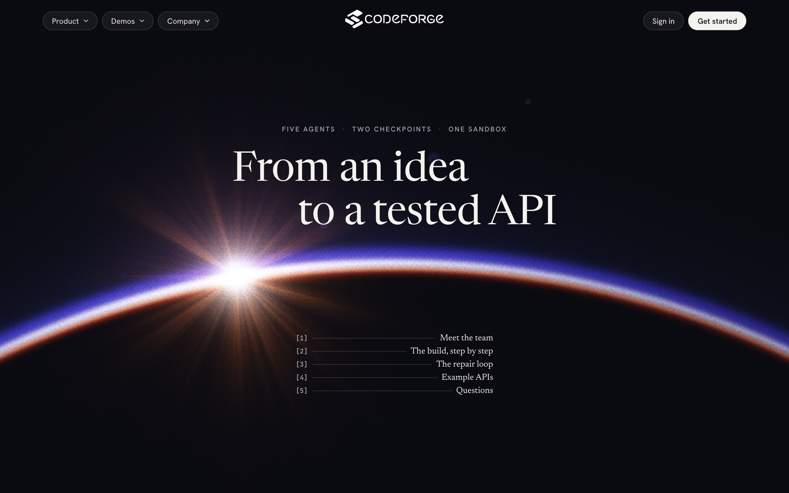
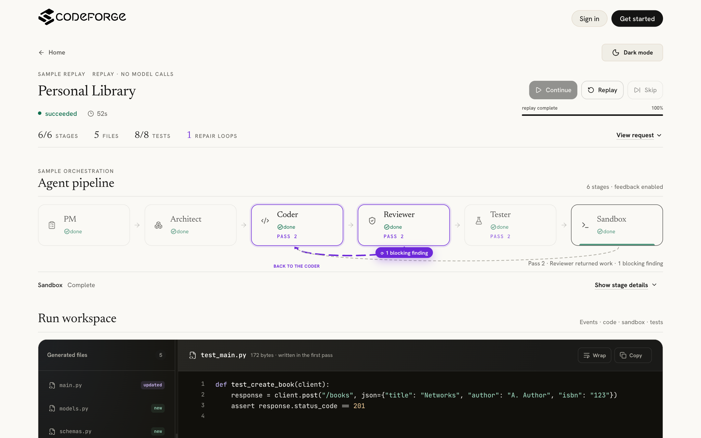
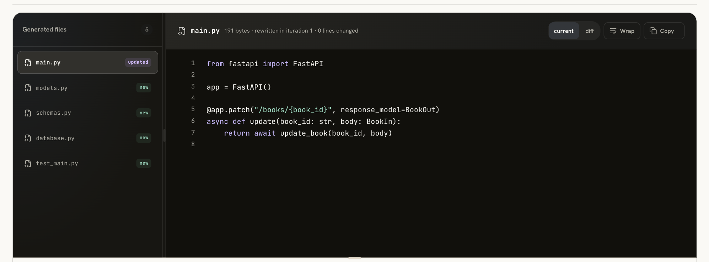
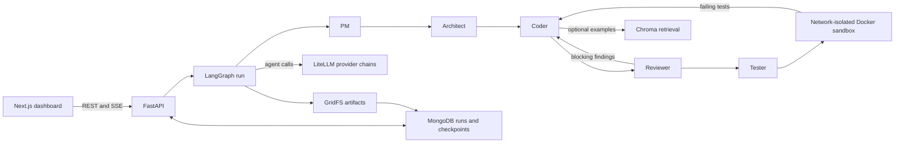

<div align="center">

# CodeForge

**From an idea to a tested API.**

A multi-agent AI platform that automates the software development life cycle. Describe an app in
plain English, and five role-based agents plan, build, review and test a working CRUD REST API,
executed live in a network-isolated Docker sandbox and streamed to a dashboard you can follow.

[](https://github.com/MihirPatel2105/CodeForge/actions/workflows/quality.yml)
[](LICENSE)


[Overview](#overview) · [How it works](#how-it-works) · [Getting started](#getting-started) ·
[Evaluation](#evaluating-the-pipeline) · [Documentation](#documentation)

</div>



## Overview

CodeForge turns one sentence into a running, tested REST API. What sets it apart is not code
generation itself, but how the work is organised and checked:

- **SDLC-mapped agent roles.** A PM, an Architect, a Coder, a Reviewer and a Tester each own
  one phase of the life cycle and hand off schema-validated output to the next.
- **A review and test feedback loop.** The Reviewer can send code back to the Coder, and failing
  sandbox tests do the same, within a bounded number of repair passes.
- **Human checkpoints.** A run pauses for your approval after the requirements and after the
  design, before a single line of code is written.
- **Real execution.** The generated API and its tests run inside a Docker sandbox with no network
  access, and the results stream to the dashboard as they happen.

The supported generation domain is deliberately narrow: single- and two-entity CRUD APIs built on
FastAPI, MongoDB and Beanie, so that what CodeForge produces is reliable rather than merely
plausible.

<p align="center">
  
  <br>
  <sub>A finished run. The Reviewer found one blocking issue, sent the code back to the Coder, and the second pass went on to pass all eight tests.</sub>
</p>

## Features

| | |
|---|---|
| **Live run dashboard** | Every agent's progress, handoff and repair loop streams over Server-Sent Events, with reconnect and replay from the last event. |
| **Approval checkpoints** | Review and approve the requirements and the design before the Coder starts. |
| **Run workspace** | Browse every generated file, compare iterations in a Diff view, and read the sandbox and test output. |
| **Use your API** | Once tests pass: try the endpoints in a private 15-minute sandbox, publish the API, or download runnable source. |
| **Publish API** | A stable URL and a one-time API key for server-side callers, with endpoint and code examples. |
| **Source download** | Includes a README and Docker Compose setup, so the API runs independently with `docker compose up --build`. |
| **Agent City** | A live miniature view of a run: six stage buildings, repair handoffs and recorded-event playback. |
| **Accounts and security** | Email-verified sign-up, password reset, two-factor authentication, passkeys and server-side session revocation. |

<p align="center">
  
  <br>
  <sub>The run workspace: every generated file, marked new or updated by the repair pass.</sub>
</p>

## How it works



1. **PM** turns the request into structured requirements. *You approve them.*
2. **Architect** designs the data model and endpoints. *You approve the design.*
3. **Coder** writes the FastAPI application, optionally guided by a curated library of examples.
4. **Reviewer** checks the code against a known checklist and can send it back with blocking findings.
5. **Tester** writes a pytest suite for the API.
6. **Sandbox** runs the app and its tests with no network access. Failures go back to the Coder.

Both loops, Reviewer to Coder and Sandbox to Coder, are capped independently at three passes, so
a run can never spend an unbounded amount of provider quota. MongoDB stores run state, LangGraph
checkpoints and per-iteration artifacts, which power stream replay and the Diff panel.

## Tech stack

| Layer | Technology |
|---|---|
| Frontend | Next.js 15 (App Router), React 19, Tailwind CSS, shadcn/ui |
| Backend | FastAPI on Python 3.11, custom JWT authentication (Argon2id) |
| Agents | LangGraph, with the MongoDB checkpointer for resumable runs |
| LLM routing | LiteLLM with per-agent fallback chains across Groq, OpenRouter and Mistral free tiers |
| Structured output | Pydantic and Instructor for schema-valid handoffs between agents |
| Retrieval | ChromaDB over a curated library of FastAPI and Beanie examples |
| Data | MongoDB with Beanie 2, and GridFS for run artifacts |
| Sandbox | Docker SDK for Python, `network_mode="none"` |
| Observability | Langfuse (self-hosted) |
| Generated apps | FastAPI, MongoDB, Beanie, pytest and httpx |

## Getting started

### Prerequisites

- Docker Desktop
- Python 3.11
- Node.js 20 or later
- git

### Quick start

```bash
git clone https://github.com/MihirPatel2105/CodeForge.git
cd CodeForge
```

The repository includes a one-command launcher. It checks prerequisites, starts the Docker
services, waits for the backend health check, runs the optional provider preflight and starts the
dashboard on port 3001.

```bash
./start.sh --demo
```

Open <http://localhost:3001> and keep the terminal open while you use CodeForge. The `--demo`
option confirms that every agent has at least one reachable AI provider before starting. A normal
development start skips that check:

```bash
./start.sh
```

```bash
./start.sh --check   # verify prerequisites without changing anything
./start.sh --stop    # stop CodeForge services
```

Press `Ctrl-C` in the launcher terminal to stop the frontend and Docker services together.

### Manual setup

<details>
<summary><b>1. Environment file</b></summary>

<br>

Each developer keeps their own `.env`; it is never committed.

```bash
cp backend/.env.example backend/.env
python3 -c "import secrets; print(secrets.token_urlsafe(48))"   # paste into JWT_SECRET
```

Add your own free-tier API keys. Groq is the primary provider; OpenRouter and Mistral back the
fallback chains. Don't share keys between team members, because free tiers are rate-limited per
account.

| Key | Where to get it |
|---|---|
| `GROQ_API_KEY` | [console.groq.com](https://console.groq.com) |
| `OPENROUTER_API_KEY` | [openrouter.ai](https://openrouter.ai) |
| `MISTRAL_API_KEY` | [console.mistral.ai](https://console.mistral.ai), the last rung of every chain |

`CEREBRAS_API_KEY` and `GOOGLE_API_KEY` remain in the example for historical configuration, but
neither provider is currently in an agent's fallback chain.

`MONGO_URI` defaults to the local `mongo` service that Docker Compose starts. It can instead point
at a MongoDB Atlas M0 free-tier cluster; the connection-string form is commented in
`.env.example`. Either way, the test suite always runs against local MongoDB
(`tests/conftest.py` pins it), so it stays fast and never touches a hosted cluster's limits.

**Email (optional).** Sign-up mails a one-time code, password resets mail a link, and
security-sensitive changes send a notice, all through `SMTP_USER` and `SMTP_PASSWORD`. Leave both
blank and the backend logs a startup warning and falls back to one-step sign-up without
verification. To turn it on with Gmail: Google Account → Security → 2-Step Verification →
**App passwords**, then use the generated password as `SMTP_PASSWORD`.

</details>

<details>
<summary><b>2. Start the stack</b></summary>

<br>

Sandbox execution requires a separate Docker daemon with mutual TLS. Set
`SANDBOX_DOCKER_HOST=tcp://<sandbox-host>:2376` and `SANDBOX_DOCKER_CERTS_DIR` to the directory
containing `ca.pem`, `cert.pem` and `key.pem`, and build `codeforge-sandbox:latest` on that
daemon. Neither Compose configuration mounts the host Docker socket. For Docker Desktop, follow
[local sandbox setup](docs/LOCAL_SANDBOX.md) to run that daemon with the optional Compose
override.

```bash
docker compose up -d
```

This starts `mongo`, `backend` (port 8000) and `langfuse` (port 3000); the first run pulls about
1 GB of images. Without the sandbox daemon, sandbox execution is unavailable; use
`docker compose up -d mongo redis` for database-only development.

</details>

<details>
<summary><b>3. Langfuse keys</b></summary>

<br>

These exist only once Langfuse is running:

1. Open <http://localhost:3000>, sign up, then create an organization and a project.
2. Go to **Settings → API Keys → Create new API key**.
3. Copy both values into `backend/.env` as `LANGFUSE_PUBLIC_KEY` and `LANGFUSE_SECRET_KEY`.

The secret key is shown only once. Langfuse runs locally, so these keys belong to one machine.

</details>

<details>
<summary><b>4. Backend development environment</b></summary>

<br>

Needed for tests, linting and running uvicorn directly. Create the virtual environment at
`backend/.venv` so the committed VS Code interpreter setting resolves.

```bash
cd backend
python3.11 -m venv .venv
source .venv/bin/activate
pip install -r requirements-dev.txt
cd .. && pre-commit install     # git hooks are not cloned; install once per clone
```

</details>

<details>
<summary><b>5. Frontend</b></summary>

<br>

```bash
cd frontend
npm install
npm run dev
```

The frontend is not part of Docker Compose and runs separately. Langfuse already uses port 3000,
so Next.js offers 3001.

</details>

### Verify the setup

```bash
curl localhost:8000/health                            # {"status":"ok"}

cd backend && source .venv/bin/activate
pytest                                                # the full suite, offline and local
PYTHONPATH=. python scripts/smoke_llm.py              # one completion, traced to Langfuse
```

The smoke script makes one LiteLLM call through Groq and traces it to Langfuse, checking keys,
routing and observability in one step.

Before a demo, check quota and reachability for every rung of every provider chain:

```bash
docker compose exec backend python scripts/preflight.py
```

It exits non-zero if any agent has no working provider, so it can gate a script as well as inform
a person. OpenRouter's daily free-request cap is the one limit no endpoint exposes, and the script
says so rather than guessing.

## Testing

| Suite | Command |
|---|---|
| Backend lint and format | `ruff check app tests scripts` and `ruff format --check app tests scripts` |
| Backend tests | `pytest -q` (from `backend/`) |
| Live sandbox tests | `RUN_LIVE_DOCKER=1 pytest -q tests/test_sandbox_live.py` |
| Frontend lint and types | `npm run lint` and `npx tsc --noEmit` (from `frontend/`) |
| Frontend build | `npm run build` |
| Browser tests | `npm run test:e2e:prod` builds for production and runs Playwright against it |

The same checks run on every push in the [Quality checks](.github/workflows/quality.yml) workflow.

## Evaluating the pipeline

The canonical evaluation is 10 frozen prompts, three repetitions and both retrieval settings, 60
slots in all. It records acceptance levels, failure categories, timing, review-loop outcomes,
provider attempts and the with-retrieval versus without-retrieval success-rate delta.

Plan the work without contacting any service:

```bash
cd backend
PYTHONPATH=. python scripts/evaluate.py --repeat 3 --dry-run
```

With MongoDB, the sandbox image and provider keys ready, run in quota-sized chunks:

```bash
PYTHONPATH=. python scripts/evaluate.py --repeat 3 --max-runs 2
```

Running the command again resumes unfinished slots. JSON and CSV results are written to
`backend/evaluation-results/`, which Git ignores. Infrastructure failures, and a provider-wide
rate limit before any completion, are recorded but excluded from the rates. If platform code or
the sandbox changes between chunks, start a new experiment with `--out-dir` pointing to a new
directory. Partial runs are not a full benchmark and shouldn't be read as a retrieval comparison.

## Deployment

The local `docker-compose.yml` and `./start.sh` are the development and demo path. Preparation
for a Vercel frontend with a Docker-capable backend host is described in
[docs/DEPLOYMENT.md](docs/DEPLOYMENT.md).

Published APIs need the CodeForge backend and Docker host to stay online. Set
`API_PUBLIC_BASE_URL` to an HTTPS backend origin for external access; published data lives in a
private Docker volume until the owner unpublishes. See [Hosted generated APIs](docs/HOSTED_APIS.md)
for limits and lifecycle details.

## Project structure

```
CodeForge/
├── backend/            FastAPI service
│   ├── app/
│   │   ├── api/        REST routes: auth, projects, runs, stream
│   │   ├── graph/      LangGraph state, nodes and loop routing
│   │   ├── agents/     agent classes: one LLM call, parsed and validated
│   │   ├── prompts/    role prompt templates
│   │   ├── llm/        LiteLLM client and the model registry
│   │   ├── rag/        ChromaDB index and the curated example library
│   │   ├── sandbox/    Docker runner, output capture and cleanup
│   │   └── events/     SSE event bus and event schemas
│   ├── scripts/        preflight, smoke test and the evaluator
│   └── tests/
├── frontend/           Next.js dashboard
│   ├── app/            App Router pages
│   ├── components/
│   ├── lib/            API client, SSE hook and the run reducer
│   └── tests/e2e/      Playwright browser tests
├── sandbox/            the pre-built image generated apps run in
├── docs/               design, specification and operations documents
└── docker-compose.yml
```

## Documentation

| Document | Covers |
|---|---|
| [SRS](docs/SRS.md) | Functional and non-functional requirements and the supported prompt domain |
| [Agents](docs/AGENTS.md) | Agent specifications, prompts and the review and test loop |
| [State and API](docs/STATE_AND_API.md) | Run state, REST routes, SSE events and data models |
| [Generated apps](docs/GENERATED_APP.md) | The file structure and rules for what the Coder produces |
| [Acceptance](docs/ACCEPTANCE.md) | Success criteria, metrics, failure categories and approvals |
| [Build phases](docs/PHASES.md) | The phase-by-phase build plan |
| [UI brief](docs/UI_BRIEF.md) | Dashboard screens, states and vocabulary |
| [Live Agent City](docs/LIVE_AGENT_CITY.md) | Agent City controls and playback |
| [Hosted generated APIs](docs/HOSTED_APIS.md) | Publishing, limits and lifecycle |
| [Local sandbox](docs/LOCAL_SANDBOX.md) | Running the sandbox daemon on Docker Desktop |
| [Deployment](docs/DEPLOYMENT.md) | Vercel frontend with a Docker-capable backend host |
| [Security hardening](docs/SECURITY_HARDENING.md) | Security controls and their rationale |
| [Admin operations](docs/ADMIN_OPERATIONS.md) | The admin panel and operational tasks |

## Development notes

- **The backend container doesn't hot-reload.** `uvicorn` runs without `--reload`, so changes to
  `backend/app/` need `docker compose restart backend`. For active development, run uvicorn from
  the virtual environment on the host instead.
- **After any `requirements.txt` change, rebuild** with `docker compose build backend`. The
  container mounts `backend/app` but bakes dependencies into the image, so new code would arrive
  without its packages and crash-loop on `ModuleNotFoundError`.
- `docker compose down` stops the stack; add `-v` to also remove the MongoDB and Langfuse volumes.

## Contributing

1. Fork the repository and create a branch off `main`.
2. Make your changes, and run the checks in [Testing](#testing).
3. Open a pull request describing what changed and why.

## License

Released under the [MIT License](LICENSE).
